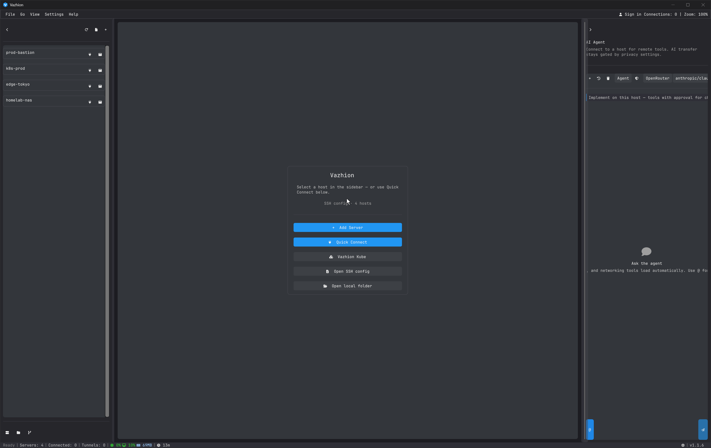
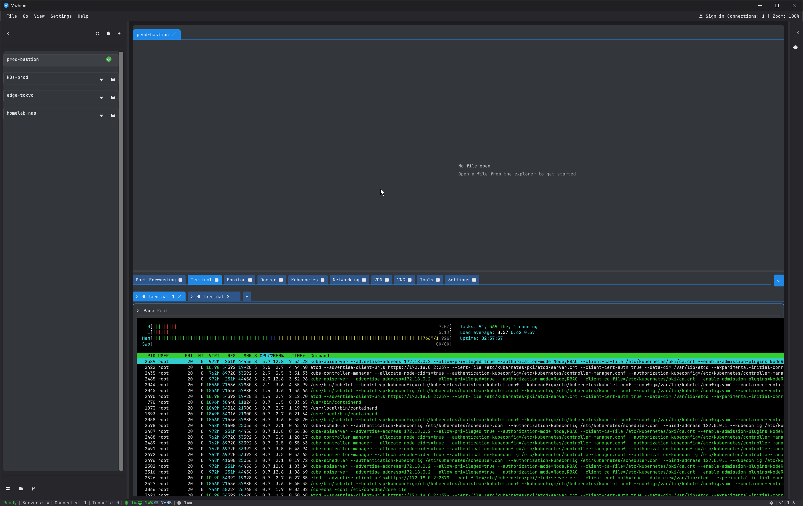
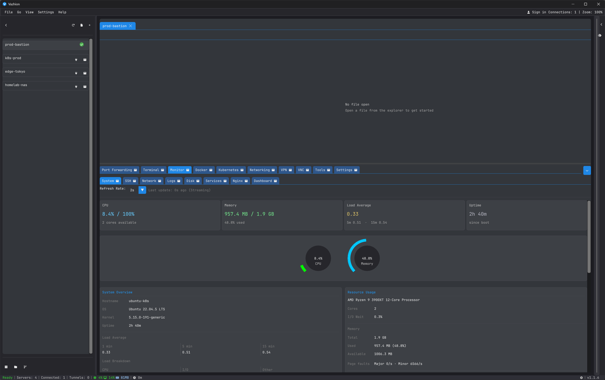
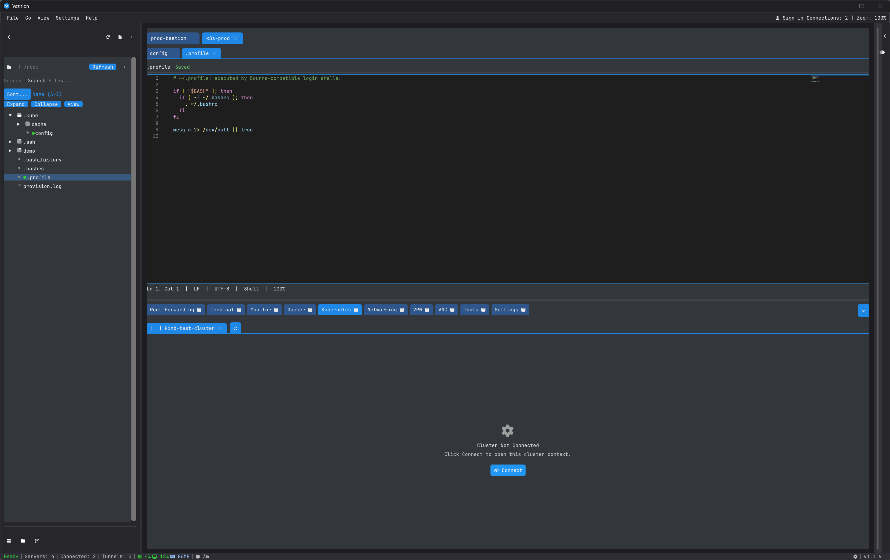
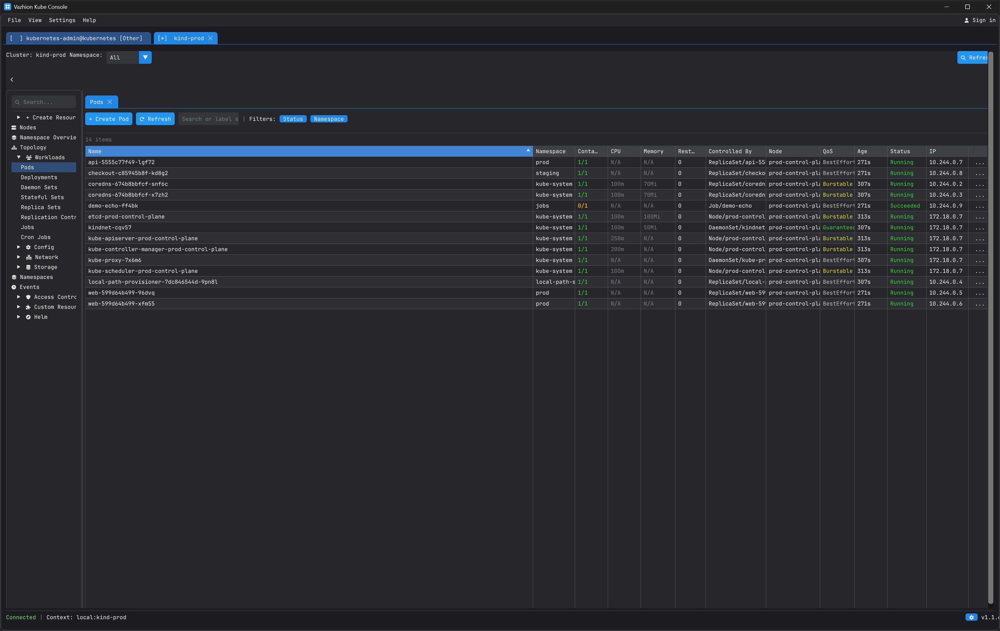

# Vazhion

[](https://github.com/vazhion/vazhion/releases/latest)
[](https://github.com/vazhion/vazhion/releases)

<p align="center">
  
</p>

Desktop app for SSH, port forwarding, terminals, Docker, and Kubernetes.

This repository is for downloads and issues. It does not contain application source, and it does not accept source pull requests.

## Screenshots

**Hosts and quick connect**



**Integrated terminal**



**Host monitor**



**Remote files and Kubernetes**



**Kube Console**



## Download

Prefer the signed Microsoft Store build on Windows. Files on [the latest release](https://github.com/vazhion/vazhion/releases/latest) are the unsigned build from the desktop app. Open that page and download the file named in the table. Those names include the version, so this page stays valid for the next release.

> [!CAUTION]
> The Windows zip is unsigned. SmartScreen can warn the first time you open it. Choose **More info**, then **Run anyway**. Check `SHA256SUMS.txt` on the same release before you run a download.

| Platform | Package | File |
| --- | --- | --- |
| Windows | Microsoft Store (signed) | Store install. The `apps.microsoft.com` product URL was not available in this workspace, so this row has no link until that URL is added. |
| Windows | [Portable zip, x64, unsigned](https://github.com/vazhion/vazhion/releases/latest) | `vazhion-Windows-x64-<version>.zip` |
| Linux | [AppImage](https://github.com/vazhion/vazhion/releases/latest) | `vazhion-Linux-x64-<version>.AppImage` |
| Linux | [Debian / Ubuntu .deb](https://github.com/vazhion/vazhion/releases/latest) | `vazhion_<version>_amd64.deb` |
| Linux | [Fedora / RHEL .rpm](https://github.com/vazhion/vazhion/releases/latest) | `vazhion-<version>-1.x86_64.rpm` |
| Linux | [Tarball](https://github.com/vazhion/vazhion/releases/latest) | `vazhion-Linux-x64-<version>.tar.gz` |
| macOS | Not in this release | — |

## Requirements

- Windows 10 version 1809 or later, 64-bit
- Linux x64
- macOS is not shipped in this release

## Install

Windows zip: extract the archive and run `vazhion.exe`.

Linux AppImage:

```sh
chmod +x vazhion-Linux-x64-*.AppImage
./vazhion-Linux-x64-*.AppImage
```

Debian or Ubuntu:

```sh
sudo apt install ./vazhion_*_amd64.deb
```

Fedora or RHEL:

```sh
sudo rpm -i vazhion-*.x86_64.rpm
```

## Verify

Each release includes `SHA256SUMS.txt`.

Linux and macOS:

```sh
sha256sum -c SHA256SUMS.txt
```

Windows PowerShell:

```powershell
Get-FileHash .\vazhion-Windows-x64-*.zip -Algorithm SHA256
```

Compare the hash with the line for that file in `SHA256SUMS.txt`.

## Issues

Use [Issues](https://github.com/vazhion/vazhion/issues) for bugs and feature requests. Include the version, operating system, and steps.

## License and privacy

- [EULA.txt](EULA.txt)
- [PRIVACY.md](PRIVACY.md)
- [THIRD_PARTY_NOTICES.md](THIRD_PARTY_NOTICES.md)
